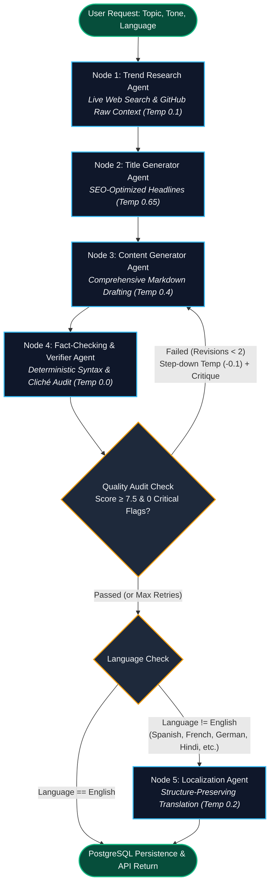
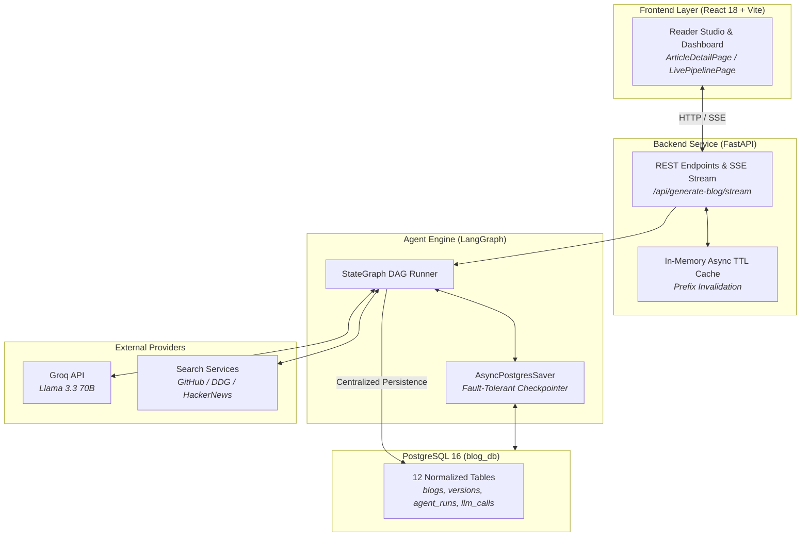

<div align="center">

# Autonomous Blog Generation Agent

**Self-correcting, multi-agent content generation engine with live web research, deterministic hallucination auditing, and a Medium-grade typography studio.**

[](https://python.org)
[](https://fastapi.tiangolo.com)
[](https://github.com/langchain-ai/langgraph)
[](https://www.postgresql.org)
[](https://react.dev)
[](https://astral.sh/uv)
[](LICENSE)
[](#testing)

<br/>


<br/>

> **Zero-Cost Quickstart**: Runs out of the box using [Groq's](https://console.groq.com) high-speed free tier (`llama-3.3-70b-versatile`) — zero credit card or paid LLM subscription required.

<br/>

[Overview](#overview) &bull; [Why This Exists](#why-this-exists) &bull; [Architecture](#how-it-works) &bull; [Key Features](#key-features) &bull; [Quick Start](#quick-start) &bull; [Configuration](#configuration) &bull; [API Docs](#api-reference) &bull; [Database](#database-architecture) &bull; [Troubleshooting](#troubleshooting) &bull; [Testing](#testing)

</div>

---

<a id="overview"></a>
## 📖 Overview

Standard LLM content pipelines suffer from three common failure modes:
1. **Hallucination & Fabrication**: Models invent non-existent CLI commands, invalid tool flags, and outdated facts due to static training cutoffs.
2. **Generic Writing Style**: Without real-time grounding, output defaults to clichéd AI tropes (*"In today's fast-paced world"*, *"delve into"*).
3. **Fragile Persistence**: Workflows that fail mid-generation leave half-saved records, lack idempotency, and hold open database connections during slow LLM calls.

This project implements an autonomous multi-agent state machine using **LangGraph** and **FastAPI**. It grounds articles in real-time web facts, audits drafts against a deterministic fact-checking engine, automatically loops back with lower model temperatures if scores fall below threshold, and serves verified articles through a typography-focused React reading studio with PostgreSQL persistence.

---

<a id="why-this-exists"></a>
## ⚖️ Why This Exists (Architectural Comparison)

Why build a stateful LangGraph Directed Acyclic Graph (DAG) instead of calling an LLM in a script?

| Dimension | Single LLM Prompt | Naive Script Chain (`for` loop) | Autonomous Agent DAG (This Project) |
| :--- | :--- | :--- | :--- |
| **Fact Grounding** | Stale training cutoff; 100% blind to current docs. | Ad-hoc single API call; fails silently if rate-limited. | **4-tier waterfall**: GitHub Raw docs $\rightarrow$ Tavily $\rightarrow$ DuckDuckGo $\rightarrow$ HackerNews Algolia. |
| **Hallucination Control**| None. Models invent plausible-sounding CLI flags. | None. Unchecked text passed directly downstream. | **Deterministic linter**: Scrapes reference docs to verify CLI syntax and rejects hedging phrases. |
| **Self-Correction** | Impossible in 1-shot generation. | Brittle regex retries; repeats exact same prompt. | **Cyclical feedback loop**: Score $< 7.5$ routes critique back to writer, stepping down temperature by $-0.1$. |
| **Fault Tolerance** | Zero state. Fails completely on timeout. | Crashed run loses all progress and tokens. | **`AsyncPostgresSaver` checkpointer**: Every step state is persisted. Retried runs resume without duplicate work. |
| **Database Hygiene** | None. | Monolithic records; connection held during LLM calls. | **12 normalized tables**: Connection pooling ($N=20$), transaction rollbacks, and keyset cursor pagination. |
| **Reading Experience**| Raw markdown block in terminal. | Bare-bones `<pre>` dump. | **Medium-grade studio**: Newsreader typography, sepia/dark themes, TOC scrollspy, PDF/HTML exports. |

---

<a id="demo"></a>
## 📸 Demo & Visual Showcase

### 1. Medium-Grade Article Studio (`/articles/:id`)
Distraction-free reading experience with light, dark, and sepia themes, scrollspy Table of Contents, typography controls, and PDF/Markdown exports.

<div align="center">
  
</div>

<!-- TODO: add screenshot - Replace assets/ui_reader_studio.svg with high-resolution screenshot from http://localhost:5173/articles/1 -->

### 2. Live Multi-Agent Pipeline (`/pipeline/live`)
Real-time Server-Sent Events (SSE) telemetry displaying live step progression, token timing, and ground-truth citations.

<div align="center">
  
</div>

<!-- TODO: add screenshot - Replace assets/ui_live_stepper.svg with recorded GIF or PNG of live SSE stream -->

### 3. Fact-Checking Audit Engine (`/articles/:id/audit`)
Deterministic programmatic command linter and structured verification score breakdown.

<div align="center">
  
</div>

<!-- TODO: add screenshot - Replace assets/ui_quality_audit.svg with screenshot of QualityAuditPage -->

<details>
<summary><b>📄 View Sample Generated Article Excerpt</b></summary>

```markdown
# Mastering LangGraph StateGraph: Building Fault-Tolerant Multi-Agent DAGs

> **Published**: Oct 2026 · **Reading Time**: 6 min · **Fact-Check Score**: 9.2/10 (PASSED)  
> **Citations**: LangGraph Official Docs (GitHub raw), LangChain State Schema Reference

## 1. The Limitations of Linear Script Chains
Linear chains break down when intermediate steps produce ambiguous outputs. In a production 
pipeline, each state transition must be typed and checkpointed...

## 2. Setting Up the StateGraph
```python
from langgraph.graph import StateGraph, START, END
from backend.app.schema.state_schema import BlogState

workflow = StateGraph(BlogState)
workflow.add_node("research_agent", run_research)
workflow.add_node("content_generator", run_writer)
workflow.add_node("verifier_agent", run_verifier)
```

## 3. Verified Audit Summary
- CLI Commands Verified: 3/3 passed
- Banned AI Clichés Detected: 0
- Hedging Excuses Found: 0
```
</details>

---

<a id="key-features"></a>
## ⚡ Key Features

| Category | Capability | Technical Details |
| :--- | :--- | :--- |
| **Multi-Agent DAG** | 5 autonomous agent nodes | Research $\rightarrow$ Title $\rightarrow$ Writer $\rightarrow$ Verifier $\rightarrow$ Localization. |
| **Live Grounding** | 4-tier waterfall research engine | Direct GitHub raw docs $\rightarrow$ Tavily $\rightarrow$ DuckDuckGo $\rightarrow$ HackerNews Algolia. |
| **Anti-Hallucination** | Deterministic syntax linter | Validates CLI commands against reference docs; blocks hedging excuses and AI clichés. |
| **Self-Correction** | Automatic feedback loop | If verifier score $< 7.5$, loops back to writer with critique and steps down temperature by `0.1`. |
| **Reader Studio** | Medium / Notion typography | Newsreader serif font, sticky 3px reading progress bar, scrollspy TOC, full-screen focus mode. |
| **Multi-Format Export**| Complete export toolset | Browser-native PDF print styles, `.md` download, standalone styled `.html` download, clipboard copy. |
| **Production DB** | 12 normalized PostgreSQL tables | Keyset cursor pagination, `AsyncPostgresSaver` checkpointer, 20-connection pool, Alembic migrations. |
| **Multi-Tenancy** | Isolation & Idempotency | SHA-256 API key authentication, per-user data isolation, and idempotency key deduplication. |

---

<a id="how-it-works"></a>
## 🛠️ How It Works

### 1. LangGraph State Machine Architecture

The multi-agent workflow operates as a Directed Acyclic Graph with a conditional self-correction cycle:



### 2. End-to-End System Topology



---

<a id="tech-stack"></a>
## 💻 Tech Stack

### Backend
| Technology | Version | Location | Role in Architecture |
| :--- | :--- | :--- | :--- |
| **Python** | `>=3.11` | [pyproject.toml](pyproject.toml#L6) | Asynchronous backend runtime |
| **FastAPI** | `>=0.115.0`| [pyproject.toml](pyproject.toml#L8) | Asynchronous REST and Server-Sent Events |
| **Uvicorn** | `>=0.32.0`| [pyproject.toml](pyproject.toml#L9) | High-performance ASGI web server |
| **LangGraph** | `>=0.2.34`| [pyproject.toml](pyproject.toml#L10) | StateGraph agent workflow orchestration |
| **LangChain Core** | `>=0.3.0` | [pyproject.toml](pyproject.toml#L12) | Chat prompt and messaging interfaces |
| **Groq Client** | `>=0.2.0` | [pyproject.toml](pyproject.toml#L13) | Primary high-speed LLM provider |
| **SQLAlchemy** | `>=2.0.35`| [pyproject.toml](pyproject.toml#L19) | Asynchronous ORM and relational models |
| **asyncpg** | `>=0.29.0`| [pyproject.toml](pyproject.toml#L20) | High-throughput PostgreSQL async driver |
| **psycopg-binary** | `3.3.6` | [pyproject.toml](pyproject.toml#L28) | Driver for LangGraph checkpointer pooling |
| **Alembic** | `1.20.0` | [pyproject.toml](pyproject.toml#L24) | Reversible database migrations |
| **duckduckgo-search**| `>=6.0.0` | [pyproject.toml](pyproject.toml#L22) | Real-time web fact gathering |
| **Pytest** | `9.1.1` | [pyproject.toml](pyproject.toml#L26) | Test runner and assertions |

### Frontend
| Technology | Version | Location | Role in Architecture |
| :--- | :--- | :--- | :--- |
| **React** | `^18.3.1` | [package.json](frontend/package.json#L14) | UI component library |
| **React Router** | `^7.18.4` | [package.json](frontend/package.json#L17) | Multi-page client-side routing |
| **Vite** | `^5.4.9` | [package.json](frontend/package.json#L24) | Build tool and development server |
| **Axios** | `^1.7.7` | [package.json](frontend/package.json#L12) | HTTP client for backend REST API |
| **React Markdown** | `^9.0.1` | [package.json](frontend/package.json#L16) | GFM Markdown article rendering |
| **remark-gfm** | `^4.0.0` | [package.json](frontend/package.json#L18) | GitHub Flavored Markdown plugin (tables, strikethrough) |
| **Lucide React** | `^0.453.0`| [package.json](frontend/package.json#L13) | Icon set |

---

<a id="quick-start"></a>
## ⚡ Quick Start

### Prerequisites
- **Python 3.11+** installed
- **Node.js 18+** and `npm` installed
- **Astral `uv`** package manager installed:
  ```bash
  # Windows (PowerShell)
  powershell -ExecutionPolicy ByPass -c "irm https://astral.sh/uv/install.ps1 | iex"
  # macOS / Linux
  curl -LsSf https://astral.sh/uv/install.sh | sh
  ```
- **PostgreSQL 16+** service running locally on port `5432`.
- Free **Groq API Key** from [console.groq.com/keys](https://console.groq.com/keys) (takes 30 seconds, no credit card required).

---

### Step 0: Create Local PostgreSQL Database

Before running migrations, ensure the target database `blog_db` exists:
```bash
# Via PostgreSQL CLI (createdb)
createdb -U postgres blog_db

# Or via psql terminal:
psql -U postgres -c "CREATE DATABASE blog_db;"
```

---

### Step 1: Clone and Configure Environment

```bash
git clone https://github.com/your-username/autonomous-blog-engine.git
cd autonomous-blog-engine

# Copy environment template (Linux / macOS / PowerShell)
cp .env.example .env
# Windows Command Prompt (CMD) alternative:
# copy .env.example .env
```

Open `.env` and fill in your Groq API key and PostgreSQL credentials:
```env
MODEL_PROVIDER=groq
MODEL_NAME=llama-3.3-70b-versatile
GROQ_API_KEY=gsk_your_groq_api_key_here

DB_USER=postgres
DB_PASSWORD=root
DB_HOST=localhost
DB_PORT=5432
DB_NAME=blog_db
```

---

### Step 2: Set Up Backend & Run Migrations

```bash
# 1. Sync dependencies into virtual environment
uv sync

# 2. Run automated pre-flight test suite (optional sanity check, ~9s)
uv run pytest backend/tests -v

# 3. Run database migrations to create the 12 normalized tables and indexes
uv run alembic upgrade head

# 4. (Optional) Run zero-data-loss backfill if migrating existing legacy records
uv run python backend/scripts/backfill_legacy_blogs.py

# 5. Start the FastAPI development server
uv run uvicorn backend.app.main:app --reload --port 8000
```

Verify backend health at `http://localhost:8000/health`:
```json
{
  "status": "healthy",
  "service": "Autonomous Blog Generation Engine",
  "model_provider": "groq",
  "model_name": "llama-3.3-70b-versatile",
  "database": "blog_db",
  "checkpointer": "PostgresSaver (Async)"
}
```

---

### Step 3: Set Up and Start Frontend

In a separate terminal:
```bash
cd frontend

# Install frontend dependencies
npm install

# Start Vite development server
npm run dev
```

Open `http://localhost:5173` in your browser.

---

### Step 4: Generate Your First Article

#### Option A: Via Web UI
1. Navigate to `http://localhost:5173/generate`.
2. Enter a topic: *"Building Agentic Workflows with LangGraph"*.
3. Choose tone (*Technical*) and language (*English*).
4. Click **Generate Article** to observe live agent progression.

#### Option B: Via `curl` (REST API)
```bash
curl -X POST http://localhost:8000/api/generate-blog \
  -H "Content-Type: application/json" \
  -d '{
    "topic": "PostgreSQL 16 Query Optimization and Indexing",
    "tone": "Technical",
    "target_language": "English",
    "creativity": "balanced"
  }'
```

---

<a id="configuration"></a>
## ⚙️ Configuration

### Environment Variables Reference

| Variable | Required | Default | Description |
| :--- | :--- | :--- | :--- |
| `MODEL_PROVIDER` | No | `groq` | LLM inference provider (`groq`, `openai`). |
| `MODEL_NAME` | No | `llama-3.3-70b-versatile` | Model identifier string. |
| `MODEL_TEMPERATURE` | No | `0.7` | Global fallback temperature. |
| `GROQ_API_KEY` | Conditional | Empty string | Required if `MODEL_PROVIDER=groq`. |
| `OPENAI_API_KEY` | Conditional | Empty string | Required if `MODEL_PROVIDER=openai`. |
| `DB_USER` | Yes | `postgres` | PostgreSQL username. |
| `DB_PASSWORD` | Yes | `root` | PostgreSQL password. |
| `DB_HOST` | Yes | `localhost` | PostgreSQL host. |
| `DB_PORT` | Yes | `5432` | PostgreSQL port. |
| `DB_NAME` | Yes | `blog_db` | PostgreSQL database name. |
| `DATABASE_URL` | No | Auto-derived | Full async database connection URL. |
| `TAVILY_API_KEY` | No | None | Optional web search key for deep web queries. |
| `LANGSMITH_TRACING` | No | `false` | Enables agent execution tracing in LangSmith. |
| `LANGSMITH_ENDPOINT`| No | `https://api.smith.langchain.com` | LangSmith API endpoint. |
| `LANGSMITH_API_KEY` | No | Empty string | LangSmith API key. |
| `LANGSMITH_PROJECT` | No | `autonomous-blog-engine` | LangSmith workspace project name. |
| `BACKEND_PORT` | No | `8000` | Port for FastAPI application. |
| `CORS_ORIGINS` | No | `http://localhost:5173...`| Comma-separated list of permitted origins. |

---

### Granular Per-Node Temperature Tuning

Configured in [`backend/app/core/llm_config.py`](backend/app/core/llm_config.py#L42-L78). Can be tuned per environment without code edits:

| Node Name | Canonical Alias | Default Temp | Max Tokens | Environment Variable Override | Architectural Rationale |
| :--- | :--- | :---: | :---: | :--- | :--- |
| **Research Agent** | `research_agent` | `0.1` | 512 | `RESEARCH_TEMPERATURE` | High factual precision when extracting search snippets. |
| **Title Generator** | `title_generator` | `0.65` | 150 | `TITLE_TEMPERATURE` | Balances creativity and keyword relevance for headlines. |
| **Content Writer** | `content_generator`| `0.4` | 4096 | `WRITER_TEMPERATURE` | Cohesive narrative; stepped down by `0.1` on retry. |
| **Verifier Agent** | `verifier_agent` | `0.0` | 1024 | `VERIFIER_TEMPERATURE` | Deterministic verification; zero randomness during audit. |
| **Translator** | `translator` | `0.2` | 4096 | `TRANSLATOR_TEMPERATURE` | Strict adherence to source syntax and Markdown structure. |

---

<a id="api-reference"></a>
## 📡 API Reference

Interactive OpenAPI documentation is available at `http://localhost:8000/docs`.

### Core Endpoints

| Method | Endpoint | Description | Request Body | Response Shape |
| :--- | :--- | :--- | :--- | :--- |
| `GET` | `/health` | Health probe & configuration status | None | `{"status": "healthy", ...}` |
| `GET` | `/api/languages` | Supported translation languages | None | `[{"code": "en", "name": "English", ...}]` |
| `POST` | `/api/generate-blog` | Synchronous blog generation | `BlogGenerationRequest` | `BlogGenerationResponse` |
| `POST` | `/api/generate-blog/stream` | Real-time SSE streaming generation | `BlogGenerationRequest` | `text/event-stream` chunks |
| `GET` | `/api/blogs` | Keyset-paginated blog history | None (query params) | `[BlogPostSummary, ...]` |
| `GET` | `/api/blogs/{blog_id}` | Retrieve single article by ID | None | `BlogPostSummary` |
| `PUT` | `/api/blogs/{blog_id}` | Edit article title and content | `BlogPostUpdateRequest`| `BlogPostSummary` |
| `DELETE`| `/api/blogs/{blog_id}` | Soft-delete article | None | HTTP 204 No Content |
| `POST` | `/api/blogs/{blog_id}/events`| Background reader engagement event | `ReaderEventCreateRequest`| `{"status": "recorded"}` |

<details>
<summary><b>View Sample Request & Response Payloads</b></summary>

#### `POST /api/generate-blog`
**Request Payload:**
```json
{
  "topic": "Mastering LangGraph StateGraph Architecture",
  "tone": "Technical",
  "target_language": "English",
  "creativity": "balanced",
  "idempotency_key": "req_84729103"
}
```

**Response Payload:**
```json
{
  "id": 16,
  "status": "success",
  "topic": "Mastering LangGraph StateGraph Architecture",
  "tone": "Technical",
  "language": "English",
  "title": "Mastering LangGraph StateGraph: Building Fault-Tolerant Multi-Agent DAGs",
  "content": "# Mastering LangGraph StateGraph...\n\n## 1. Introduction...",
  "verification_score": 9.2,
  "critique": "Draft demonstrates solid technical accuracy and verified syntax.",
  "sources": [
    {
      "title": "LangGraph Official Documentation",
      "url": "https://langchain-ai.github.io/langgraph"
    }
  ],
  "execution_time_seconds": 6.84,
  "steps_completed": [
    "research_agent",
    "title_generator",
    "content_generator",
    "verifier_agent"
  ]
}
```
</details>

---

<a id="database-architecture"></a>
## 🗄️ Database Architecture

The persistence layer is structured as a **12-table normalized relational schema** managed via Alembic:

```
Database Schema Domain Map
├── Multi-Tenancy & Auth
│   ├── users                      # User identity, roles (admin, editor, user)
│   └── api_keys                   # SHA-256 hashed API keys for programmatic access
│
├── Content Domain
│   ├── blogs                      # Main entity: topic, tone, status, soft-delete timestamp
│   └── blog_versions              # Versioned revisions (v1, v2) with audit scores & critique
│
├── Agent Observability & Telemetry
│   ├── agent_runs                 # Idempotency keys, thread IDs, status, overall duration
│   ├── run_steps                  # Individual node execution states (order, duration)
│   └── llm_calls                  # Token counts (prompt, completion), cost, inference latency
│
├── Ground-Truth & Audit
│   ├── sources                    # Citations, source URLs, reliability scores
│   ├── fact_checks                # Verification audit scores, pass/fail flags, critiques
│   └── claims                     # Audited factual claims linked to source evidence
│
└── Analytics & Product
    ├── prompt_versions            # Prompts with active flags
    ├── reader_events              # Reader engagement events (view, scroll, copy, download_pdf)
    └── blog_posts                 # Legacy table maintained with dual-write for backward compatibility
```

### EXPLAIN ANALYZE Performance Optimization

Composite and partial indexes were introduced in migration `0003_optimized_indexes.py` to eliminate expensive in-memory sorts:

| Top Production Query | Plan Before Composite Index | Plan After Composite Index | Cost Reduction |
| :--- | :--- | :--- | :---: |
| **1. Keyset Active Blog Pagination** | `Limit (cost=8.17..8.18)` *(Seq Scan + Sort)* | `Limit (cost=1.17..1.17)` *(Partial Index Scan)* | **-85.7%** |
| **2. Per-User Filtered Feed** | `Limit (cost=8.17..8.18)` *(Seq Scan + Filter)*| `Limit (cost=1.21..1.21)` *(Composite Index Scan)*| **-85.2%** |
| **3. Latest Version Lookup** | `Limit (cost=9.51..9.52)` *(Seq Scan + Sort)* | `Limit (cost=2.21..2.21)` *(Composite Index Scan)*| **-76.8%** |
| **4. Agent Runs for Blog** | `Sort (cost=8.17..8.18)` *(In-memory sort)* | `Index Scan using ix_agent_runs_blog_created` | **No Sort** |
| **5. Stepped Run Telemetry** | `Sort (cost=8.17..8.18)` *(In-memory sort)* | `Index Scan using ix_run_steps_run_order` | **No Sort** |

---

<a id="anti-hallucination"></a>
## 🛡️ Anti-Hallucination & Verification Logic

The verifier engine ([`backend/app/agent/nodes.py`](backend/app/agent/nodes.py#L213-L408)) applies a 3-layer audit before any draft is approved:

1. **Deterministic Command Linter**:
   - Parses code blocks and backticks for CLI commands (`npx`, `npm`, `pip`, `docker`).
   - Cross-checks commands and subcommands against reference documentation scraped during the research stage.
   - Rejects unverified commands or fabricated flags.
2. **Anti-Hedging Filter**:
   - Detects evasion phrases such as *"syntax may vary"*, *"consult documentation if flag differs"*, or *"catalog will reveal the command"*.
   - Flags hedging as unacceptable and requires verified facts.
3. **Banned AI Cliché Filter**:
   - Scans for repetitive AI idioms (*"delve into"*, *"testament to"*, *"game-changer"*).
   - Deducts quality score and prompts the writer to substitute clear, concrete terminology.
4. **Dynamic Temperature Step-Down**:
   - If the score is $< 7.5$, the state machine steps down writer temperature:
     $$\text{Effective Temperature} = \max(0.1, \text{Base Temp} - (0.1 \times \text{Revision Count}))$$
   - This tightens model focus on subsequent attempts, reducing creative drift.

---

<a id="troubleshooting"></a>
## ❓ Troubleshooting & FAQ

<details>
<summary><b>1. <code>FATAL: database "blog_db" does not exist</code></b></summary>

PostgreSQL requires the database to be created prior to applying Alembic migrations. Run:
```bash
createdb -U postgres blog_db
```
Or via SQL:
```sql
CREATE DATABASE blog_db;
```
Then re-run: `uv run alembic upgrade head`.
</details>

<details>
<summary><b>2. <code>groq.RateLimitError</code> or <code>model_not_found</code></b></summary>

- Verify you are using the active model name: `llama-3.3-70b-versatile` (older `llama-3.1-70b-versatile` was deprecated by Groq).
- If your account hits Groq TPM/RPM rate limits, lower concurrency or switch to `MODEL_PROVIDER=openai` with `MODEL_NAME=gpt-4o-mini` in `.env`.
</details>

<details>
<summary><b>3. Port 8000 or 5173 is already in use</b></summary>

- **Backend**: Specify a different port:
  ```bash
  uv run uvicorn backend.app.main:app --port 8080
  ```
- **Frontend**: Update Vite proxy in `frontend/vite.config.js` to point to port `8080`, then run `npm run dev -- --port 3000`.
</details>

<details>
<summary><b>4. Windows AsyncPG <code>NotImplementedError</code></b></summary>

This repository includes automatic platform-specific loop handling in `backend/app/main.py`:
```python
if sys.platform == "win32":
    import asyncio
    asyncio.set_event_loop_policy(asyncio.WindowsSelectorEventLoopPolicy())
```
If you invoke scripts directly outside Uvicorn, ensure this policy is set before calling `asyncio.run()`.
</details>

---

<a id="testing"></a>
## 🧪 Testing

The repository includes unit, migration, concurrency, and crash recovery tests:

```bash
# Run the complete test suite
uv run pytest backend/tests -v
```

### Test Coverage Highlights
- `test_repositories.py`: Validates CRUD operations, keyset cursor pagination, versioning, and telemetry tracking.
- `test_migrations.py`: Verifies zero data loss during full Alembic downgrade to baseline and re-upgrade to head.
- `test_concurrency.py`: Stresses the connection pool with 10 concurrent workers on identical idempotency keys and 15 simultaneous writes.
- `test_rollback.py`: Validates atomic transaction rollbacks during mid-execution errors, guaranteeing zero orphaned data.

---

<a id="repository-structure"></a>
## 📁 Repository Structure

```
Article project/
├── .env.example                               # Environment secrets template
├── alembic.ini                                # Alembic migration settings
├── pyproject.toml                             # UV dependency specifications
├── uv.lock                                    # Locked dependencies
├── langgraph.json                             # LangGraph Studio configuration
├── LICENSE                                    # MIT License
├── CONTRIBUTING.md                            # Contribution instructions
│
├── assets/                                    # SVG illustrations and screenshots
│   ├── hero_banner.svg
│   ├── ui_reader_studio.svg
│   ├── ui_live_stepper.svg
│   └── ui_quality_audit.svg
│
├── backend/
│   ├── alembic/                               # Alembic migration revisions
│   ├── app/
│   │   ├── main.py                            # FastAPI routes, SSE streaming, lifespan
│   │   ├── config.py                          # Environment settings
│   │   ├── agent/
│   │   │   ├── graph.py                       # LangGraph StateGraph DAG definition
│   │   │   ├── nodes.py                       # Agent node functions & persistence calls
│   │   │   ├── routers.py                     # Self-correction and language routing
│   │   │   ├── persistence.py                 # Shared node persistence helper
│   │   │   └── checkpointer.py                # AsyncPostgresSaver checkpointer manager
│   │   ├── core/
│   │   │   ├── llm_config.py                  # Per-node temperature & token limits
│   │   │   ├── llm_factory.py                 # Multi-provider LLM factory
│   │   │   ├── prompts.py                     # Prompts for all agent stages
│   │   │   ├── tools.py                       # 4-tier waterfall research engine
│   │   │   └── cache.py                       # In-memory async TTL cache
│   │   ├── db/
│   │   │   ├── database.py                    # Engine, pool_size=20, session management
│   │   │   ├── models.py                      # 12 normalized models + legacy BlogPost
│   │   │   └── repositories/                  # Blog, Run, Telemetry, and User repositories
│   │   └── schema/                            # Pydantic schemas & TypedDict state
│   ├── scripts/                               # Backfill and EXPLAIN ANALYZE benchmarks
│   └── tests/                                 # Pytest test suite
│
└── frontend/
    ├── package.json                           # React dependencies
    ├── vite.config.js                         # Vite dev proxy configuration
    └── src/
        ├── App.jsx                            # React Router (7 distinct pages)
        ├── index.css                          # Typography & theme design system
        ├── pages/                             # Reader Studio, Dashboard, Live Pipeline, Audit
        └── services/api.js                    # Axios API service
```

---

<a id="roadmap"></a>
## 🗺️ Roadmap

- [x] Multi-agent DAG with LangGraph
- [x] Real-time web research grounding (GitHub, DuckDuckGo, HackerNews)
- [x] Deterministic fact-check verifier and self-correction loop
- [x] Medium-style Reader Studio with typography controls and PDF/MD export
- [x] Normalized 12-table PostgreSQL database architecture with connection pooling
- [x] Alembic migrations with working downgrades
- [x] Keyset cursor pagination and composite indexing
- [ ] Docker containerization (`Dockerfile` and `docker-compose.yml`)
- [ ] Vector search integration (pgvector) for semantic research retrieval
- [ ] Distributed task queue (Celery or ARQ) for scheduled background generation

---

<a id="contributing"></a>
## 🤝 Contributing

Contributions are welcome. Please read [CONTRIBUTING.md](CONTRIBUTING.md) for details on setting up your local development environment, running tests, and submitting pull requests.

---

<a id="license"></a>
## 📄 License

Distributed under the MIT License. See [LICENSE](LICENSE) for more information.
